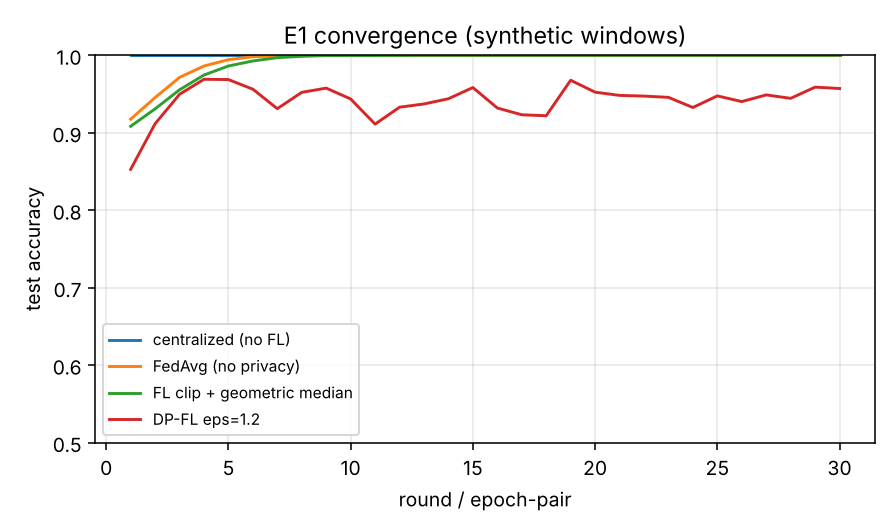
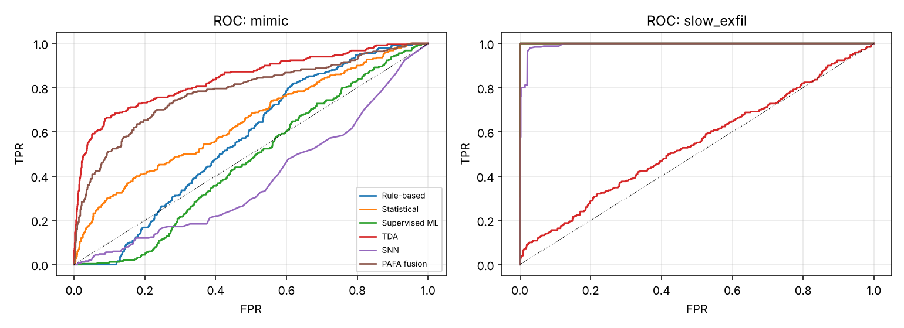
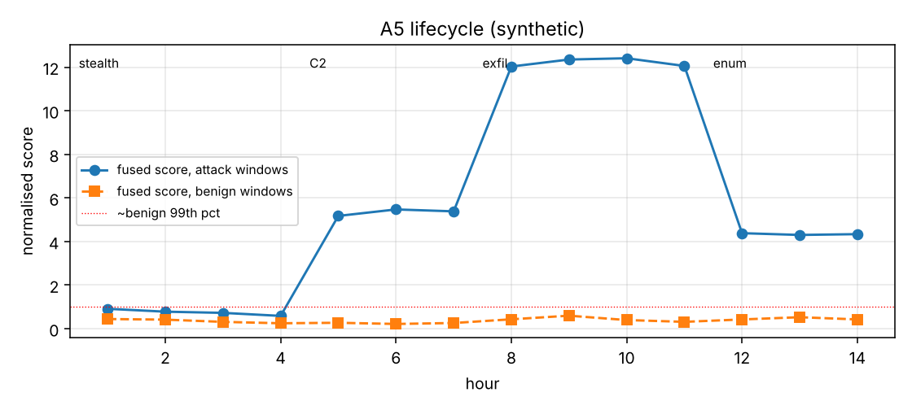

# PAFA-DoH Chapter 4: experiments, attack scenarios and performance (v2 artifact)

All numbers below were produced by running the scripts in this repository on the machine described at the end. Traffic is synthetic (pafa_v2/windows_v2.py), the model is a small MLP over 17 window features, and cryptographic components are didactic software references. These are not the values of Tables 13-17 of the thesis; they show how each mechanism behaves under controlled conditions, with uncertainty, and where the thesis figures depend on hardware or testbed data that this repository does not contain.

## 1. Claim-by-claim comparison

| Chapter 4 item                                   | thesis value                                       | this simulation                                                                            | reading                                                             |
|:-------------------------------------------------|:---------------------------------------------------|:-------------------------------------------------------------------------------------------|:--------------------------------------------------------------------|
| Accuracy at eps=1.2 (Table 16)                   | >= 99.2 % target, 99.4 % achieved                  | known families 0.9571 ± 0.0554 (K=400)                                                     | depends on client population; see E6                                |
| Client population needed at eps=1.2              | number of clients not stated                       | K=100: 0.9459 ± 0.0378; K=400: 0.9571 ± 0.0554; K=1600: 0.9999 ± 0.0002                    | noise on the average falls as 1/K; K is a first-order parameter     |
| Convergence epochs (Table 16)                    | 8 epochs, target <= 10                             | FedAvg reaches 95 % (known families) in rounds [2, 2, 4]                                   | easy synthetic task; not comparable in absolute terms               |
| Dropout resilience (Table 16)                    | 97.3 % recovery at up to 20 % dropout              | 100.00% of 0 %-dropout accuracy at 20 %                                                    | FedAvg is insensitive to random absence here                        |
| Byzantine robustness (Sec 4.6.3)                 | geometric median + cross-check, fraction in 4.28.1 | 20 % sign-flip: mean 0.1219 ± 0.0411, geomed 1.0000 ± 0.0000, +cross-check 1.0000 ± 0.0000 | plain mean collapses; geometric median holds                        |
| Adversarial robustness (Table 16)                | 96.8 % under GAN-crafted queries                   | recall@0.5 FGSM: standard 0.2356 ± 0.0856, augmented 0.7296 ± 0.0029                       | FGSM augmentation, not the thesis GAN; same direction of effect     |
| Tunnelling detection (Table 14: 99.5 %)          | 99.5 %                                             | PAFA fusion 100.0% [98%,100%], FPR 1.067% [0.66%,1.73%]                                    | simulated dnscat2-like traffic                                      |
| C2 heartbeat (Table 14: 98.7 %)                  | 98.7 %                                             | PAFA fusion 100.0% [98%,100%]                                                              | simulated periodic beacon                                           |
| Zero-day / evasive family                        | 'identifying zero-day attacks' (Sec 4.30.3)        | mimic: PAFA fusion 18.4% [14%,24%]                                                         | hardest family; TDA alone 26.8% [22%,33%], statistical 4.8% [3%,8%] |
| Betti-1 separation (Table 17: 2.1 vs 5.8)        | 2.1 ± 0.3 vs 5.8 ± 1.2                             | mimic: 0.24 ± 0.50 vs 0.44 ± 0.62 (delay-embedded IAT)                                     | different representation, different scale                           |
| SNR reduction 98 % (Sec 4.14)                    | 98 % (ChipWhisperer)                               | x50 injection: 98.0% by construction; CPA success at n=800: 0.02                           | model; hardware result not reproduced                               |
| 128-bit PQ security of Ring-LWE layer (Sec 4.21) | n=256, q=4096, 128-bit target                      | core-SVP estimate 65.7 classical / 59.6 quantum bits                                       | parameter pair does not reach the target under this estimate        |
| Loihi 0.8 ms / 0.12 mJ vs A100 (Table 13)        | 2.6x / 15x                                         | not reproducible without the hardware                                                      | CPU numbers in B7 are a baseline only                               |
| Groth16 432 ms / 78 ms / 1.8 KB (Table 15)       | 432 / 78 / 1.8                                     | not reproducible: toy QAP and FRI only                                                     | B2/B3 give scaling shapes, not these times                          |

## 2. Federated training (E1-E6)

Setup: label-skewed clients (Dirichlet 0.7), 2 local epochs per round, MLP 17-24-1, client-level clipping C=3.5, Gaussian noise inside the average, delta=1e-5, accountant of Eq. 60. Training families: benign, tunnel, beacon, slow_exfil; 'mimic' is held out and never seen in training.

### E1 Convergence and final quality

| method                     | acc_known_families   | acc_incl_zero-day   | final_auc       | tpr             | fpr             | recall_mimic (zero-day)   | rounds_to_90%(known)   | rounds_to_95%(known)   |
|:---------------------------|:---------------------|:--------------------|:----------------|:----------------|:----------------|:--------------------------|:-----------------------|:-----------------------|
| centralized (no FL)        | 1.0000 ± 0.0000      | 0.8750 ± 0.0000     | 0.8896 ± 0.0071 | 0.7500 ± 0.0000 | 0.0000 ± 0.0000 | 0.0000 ± 0.0000           | [1, 1, 1]              | [1, 1, 1]              |
| FedAvg (no privacy)        | 1.0000 ± 0.0000      | 0.8750 ± 0.0000     | 0.8896 ± 0.0160 | 0.7500 ± 0.0000 | 0.0000 ± 0.0000 | 0.0000 ± 0.0000           | [1, 1, 3]              | [2, 2, 4]              |
| FL clip + geometric median | 1.0000 ± 0.0000      | 0.8750 ± 0.0000     | 0.8899 ± 0.0171 | 0.7500 ± 0.0000 | 0.0000 ± 0.0000 | 0.0000 ± 0.0000           | [1, 1, 3]              | [2, 2, 5]              |
| DP-FL eps=1.2              | 0.9571 ± 0.0554      | 0.8383 ± 0.0495     | 0.8784 ± 0.0701 | 0.6804 ± 0.0999 | 0.0038 ± 0.0022 | 0.0071 ± 0.0139           | [1, 2, 3]              | [3, 4, 3]              |

### E2 Privacy-utility trade-off

| eps_target     | sigma   | noise_std_on_avg   | acc_known       | acc_all         | auc             | fpr             | recall_mimic    |
|:---------------|:--------|:-------------------|:----------------|:----------------|:----------------|:----------------|:----------------|
| 0.25           | 105.70  | 0.925              | 0.7716 ± 0.1235 | 0.6827 ± 0.1082 | 0.7504 ± 0.1060 | 0.1149 ± 0.0333 | 0.0604 ± 0.0553 |
| 0.5            | 53.13   | 0.465              | 0.8743 ± 0.1085 | 0.7687 ± 0.0961 | 0.8340 ± 0.0804 | 0.0296 ± 0.0140 | 0.0293 ± 0.0318 |
| 1.2            | 22.46   | 0.197              | 0.9571 ± 0.0554 | 0.8383 ± 0.0495 | 0.8784 ± 0.0701 | 0.0038 ± 0.0022 | 0.0071 ± 0.0139 |
| 3.0            | 9.30    | 0.081              | 0.9996 ± 0.0007 | 0.8747 ± 0.0007 | 0.8820 ± 0.0504 | 0.0000 ± 0.0000 | 0.0000 ± 0.0000 |
| 8.0            | 3.78    | 0.033              | 1.0000 ± 0.0000 | 0.8750 ± 0.0000 | 0.8932 ± 0.0214 | 0.0000 ± 0.0000 | 0.0000 ± 0.0000 |
| inf (no noise) | -       | -                  | 1.0000 ± 0.0000 | 0.8750 ± 0.0000 | 0.8896 ± 0.0160 | 0.0000 ± 0.0000 | 0.0000 ± 0.0000 |

### E3 Client dropout

| dropout          | acc_known       | auc             | recovery_vs_0%_dropout   |
|:-----------------|:----------------|:----------------|:-------------------------|
| 0%               | 1.0000 ± 0.0000 | 0.8896 ± 0.0160 | 100.00%                  |
| 10%              | 1.0000 ± 0.0000 | 0.8894 ± 0.0161 | 100.00%                  |
| 20%              | 1.0000 ± 0.0000 | 0.8895 ± 0.0162 | 100.00%                  |
| 30%              | 1.0000 ± 0.0000 | 0.8894 ± 0.0163 | 100.00%                  |
| 40%              | 1.0000 ± 0.0000 | 0.8894 ± 0.0163 | 100.00%                  |
| 20% (DP eps=1.2) | 0.9406 ± 0.0670 | 0.8718 ± 0.0670 | -                        |

### E4 Byzantine clients (accuracy on known families)

| attack    | byz_frac   | mean            | clipmean        | geomed          | geomed_xcheck   |   xcheck_excluded |
|:----------|:-----------|:----------------|:----------------|:----------------|:----------------|------------------:|
| signflip  | 0%         | 1.0000 ± 0.0000 | 1.0000 ± 0.0000 | 1.0000 ± 0.0000 | 1.0000 ± 0.0000 |              0.01 |
| signflip  | 10%        | 1.0000 ± 0.0000 | 1.0000 ± 0.0000 | 1.0000 ± 0.0000 | 1.0000 ± 0.0000 |              0.03 |
| signflip  | 20%        | 0.1219 ± 0.0411 | 0.1615 ± 0.0898 | 1.0000 ± 0.0000 | 1.0000 ± 0.0000 |              0.04 |
| signflip  | 30%        | 0.1429 ± 0.0000 | 0.0651 ± 0.0634 | 1.0000 ± 0.0000 | 1.0000 ± 0.0000 |              0.06 |
| labelflip | 10%        | 1.0000 ± 0.0000 | 1.0000 ± 0.0000 | 1.0000 ± 0.0000 | 1.0000 ± 0.0000 |              0.09 |
| labelflip | 20%        | 1.0000 ± 0.0000 | 1.0000 ± 0.0000 | 1.0000 ± 0.0000 | 1.0000 ± 0.0000 |              0.16 |
| labelflip | 30%        | 1.0000 ± 0.0000 | 1.0000 ± 0.0000 | 1.0000 ± 0.0000 | 1.0000 ± 0.0000 |              0.24 |

### E5 Evasion robustness

| training                                    | clean_acc_known   | clean_recall    | recall@0.1      | recall@0.2      | recall@0.3      | recall@0.5      |
|:--------------------------------------------|:------------------|:----------------|:----------------|:----------------|:----------------|:----------------|
| FL standard                                 | 1.0000 ± 0.0000   | 0.7500 ± 0.0000 | 0.7500 ± 0.0000 | 0.7458 ± 0.0019 | 0.6751 ± 0.0298 | 0.2356 ± 0.0856 |
| FL + adversarial augmentation (eps_adv=0.3) | 1.0000 ± 0.0000   | 0.7500 ± 0.0000 | 0.7500 ± 0.0000 | 0.7500 ± 0.0000 | 0.7500 ± 0.0000 | 0.7296 ± 0.0029 |

### E6 Client population at eps=1.2

|   clients_K |   samples_per_client |   sigma |   noise_std_on_avg | acc_known_at_eps_1.2   | auc             |
|------------:|---------------------:|--------:|-------------------:|:-----------------------|:----------------|
|         100 |                  160 |   22.46 |              0.786 | 0.9459 ± 0.0378        | 0.8568 ± 0.0420 |
|         400 |                   40 |   22.46 |              0.197 | 0.9571 ± 0.0554        | 0.8784 ± 0.0701 |
|        1600 |                   10 |   22.46 |              0.049 | 0.9999 ± 0.0002        | 0.8916 ± 0.0303 |

## 3. Attack scenarios and detection (A1-A7)

Every detector is thresholded at the same 1 % false-positive budget on a separate benign calibration set; TPR and FPR carry Wilson 95 % intervals. The supervised baseline sees only tunnel and beacon during training.

### A1 Scenario catalogue

| scenario   | behaviour (simulated)                                                                | thesis section   |
|:-----------|:-------------------------------------------------------------------------------------|:-----------------|
| benign     | browsing bursts (73 %), periodic telemetry polling (15 %), CDN hash labels (12 %)    | -                |
| tunnel     | dnscat2-like: 28-52 char base32 labels, TXT/CNAME/MX heavy, ~0.15-1 s spacing        | 4.26.1           |
| beacon     | C2 heartbeat: 2-10 s period, 4-15 % jitter, short hex labels, constant small payload | 4.26.4           |
| slow_exfil | low-and-slow: 12-45 s mean spacing, 18-30 char labels, TXT heavy                     | 4.26.1           |
| mimic      | benign-looking names/sizes/types, hidden cyclic rate modulation (zero-day style)     | 4.2.1, 4.26.2    |
| enum       | subdomain enumeration host0..hostN, sequential, fast (lifecycle phase 4 only)        | 4.30.4           |

### A2 Detector comparison

| detector                                 | FPR (benign test)    | TPR tunnel        | TPR beacon        | TPR slow_exfil    | TPR mimic       | mean TPR   |   mean AUC |
|:-----------------------------------------|:---------------------|:------------------|:------------------|:------------------|:----------------|:-----------|-----------:|
| Rule-based (static thresholds)           | 0.867% [0.51%,1.48%] | 100.0% [98%,100%] | 0.0% [0%,2%]      | 100.0% [98%,100%] | 0.0% [0%,2%]    | 50.0%      |      0.862 |
| Statistical (Mahalanobis, benign only)   | 0.933% [0.56%,1.56%] | 100.0% [98%,100%] | 100.0% [98%,100%] | 100.0% [98%,100%] | 4.8% [3%,8%]    | 76.2%      |      0.911 |
| Supervised ML (trained on tunnel+beacon) | 0.667% [0.36%,1.22%] | 100.0% [98%,100%] | 100.0% [98%,100%] | 100.0% [98%,100%] | 0.0% [0%,2%]    | 75.0%      |      0.868 |
| TDA (persistence, delay-embedded IAT)    | 1.000% [0.61%,1.64%] | 4.0% [2%,7%]      | 1.6% [1%,4%]      | 6.4% [4%,10%]     | 26.8% [22%,33%] | 9.7%       |      0.616 |
| SNN (LIF + STDP, benign-trained)         | 1.000% [0.61%,1.64%] | 99.6% [98%,100%]  | 1.2% [0%,3%]      | 80.0% [75%,84%]   | 0.4% [0%,2%]    | 45.3%      |      0.757 |
| PAFA fusion (stat + TDA + SNN, max)      | 1.067% [0.66%,1.73%] | 100.0% [98%,100%] | 100.0% [98%,100%] | 100.0% [98%,100%] | 18.4% [14%,24%] | 79.6%      |      0.945 |

### A3 Fusion ablation

| detector                   | FPR (benign test)    | TPR tunnel        | TPR beacon        | TPR slow_exfil    | TPR mimic       | mean TPR   |   mean AUC |
|:---------------------------|:---------------------|:------------------|:------------------|:------------------|:----------------|:-----------|-----------:|
| fusion without Statistical | 1.333% [0.86%,2.05%] | 99.6% [98%,100%]  | 2.8% [1%,6%]      | 80.0% [75%,84%]   | 25.2% [20%,31%] | 51.9%      |      0.843 |
| fusion without TDA         | 1.267% [0.81%,1.97%] | 100.0% [98%,100%] | 100.0% [98%,100%] | 100.0% [98%,100%] | 4.0% [2%,7%]    | 76.0%      |      0.891 |
| fusion without SNN         | 1.333% [0.86%,2.05%] | 100.0% [98%,100%] | 100.0% [98%,100%] | 100.0% [98%,100%] | 21.6% [17%,27%] | 80.4%      |      0.957 |

### A4 Topological features (permutation test)

| scenario   | feature             | benign mean ± sd   | attack mean ± sd   |   cohen_d |   p (perm) | reject @ alpha/3   |
|:-----------|:--------------------|:-------------------|:-------------------|----------:|-----------:|:-------------------|
| tunnel     | betti1              | 0.24 ± 0.50        | 0.23 ± 0.49        |     -0.03 |     0.6798 | no                 |
| tunnel     | persistence_entropy | 1.92 ± 0.27        | 1.81 ± 0.30        |     -0.39 |     0.0003 | yes                |
| tunnel     | wasserstein_to_ref  | 0.28 ± 0.06        | 0.30 ± 0.07        |      0.27 |     0.0007 | yes                |
| beacon     | betti1              | 0.24 ± 0.50        | 0.24 ± 0.51        |      0    |     1      | no                 |
| beacon     | persistence_entropy | 1.92 ± 0.27        | 1.93 ± 0.29        |      0.06 |     0.3675 | no                 |
| beacon     | wasserstein_to_ref  | 0.28 ± 0.06        | 0.28 ± 0.07        |      0.05 |     0.4652 | no                 |
| slow_exfil | betti1              | 0.24 ± 0.50        | 0.22 ± 0.46        |     -0.04 |     0.5785 | no                 |
| slow_exfil | persistence_entropy | 1.92 ± 0.27        | 1.81 ± 0.35        |     -0.39 |     0.0003 | yes                |
| slow_exfil | wasserstein_to_ref  | 0.28 ± 0.06        | 0.30 ± 0.08        |      0.25 |     0.0007 | yes                |
| mimic      | betti1              | 0.24 ± 0.50        | 0.44 ± 0.62        |      0.38 |     0.0003 | yes                |
| mimic      | persistence_entropy | 1.92 ± 0.27        | 1.51 ± 0.43        |     -1.37 |     0.0003 | yes                |
| mimic      | wasserstein_to_ref  | 0.28 ± 0.06        | 0.40 ± 0.09        |      1.82 |     0.0003 | yes                |

### A5 Multi-phase lifecycle

| phase                                    | Rule-based (static thresholds)   | Statistical (Mahalanobis, benign only)   | Supervised ML (trained on tunnel+beacon)   | TDA (persistence, delay-embedded IAT)   | SNN (LIF + STDP, benign-trained)   | PAFA fusion (stat + TDA + SNN, max)   |
|:-----------------------------------------|:---------------------------------|:-----------------------------------------|:-------------------------------------------|:----------------------------------------|:-----------------------------------|:--------------------------------------|
| stealth set-up (h1-4, mimic)             | 0.0%                             | 1.6%                                     | 0.0%                                       | 24.0%                                   | 0.0%                               | 10.6%                                 |
| C2 beaconing (h5-7, beacon)              | 0.0%                             | 100.0%                                   | 100.0%                                     | 0.0%                                    | 0.0%                               | 100.0%                                |
| query-flood exfiltration (h8-11, tunnel) | 100.0%                           | 100.0%                                   | 100.0%                                     | 5.0%                                    | 100.0%                             | 100.0%                                |
| subdomain enumeration (h12-14, enum)     | 0.0%                             | 100.0%                                   | 0.0%                                       | 6.1%                                    | 1.8%                               | 100.0%                                |
| benign false-alarm rate (all hours)      | 1.7%                             | 0.0%                                     | 0.9%                                       | 1.7%                                    | 2.4%                               | 0.8%                                  |

### A6 Simulated CPA key recovery

| countermeasure                                 | total noise sd              | ||s||/||n|| (Eq. 47)   | ratio reduction   | n=25         | n=50         | n=100        | n=200        | n=400        | n=800        | n=1600       | n=3200       |
|:-----------------------------------------------|:----------------------------|:-----------------------|:------------------|:-------------|:-------------|:-------------|:-------------|:-------------|:-------------|:-------------|:-------------|
| none (measurement noise only)                  | 1.00                        | 1.414                  | 0.0%              | 0.98         | 1.00         | 1.00         | 1.00         | 1.00         | 1.00         | 1.00         | 1.00         |
| static injection, amplitude x2.5               | 2.69                        | 0.525                  | 62.9%             | 0.25         | 0.53         | 0.95         | 1.00         | 1.00         | 1.00         | 1.00         | 1.00         |
| static injection, amplitude x8                 | 8.06                        | 0.175                  | 87.6%             | 0.00         | 0.05         | 0.10         | 0.33         | 0.57         | 0.93         | 1.00         | 1.00         |
| static injection, amplitude x25                | 25.02                       | 0.057                  | 96.0%             | 0.00         | 0.00         | 0.02         | 0.00         | 0.03         | 0.12         | 0.17         | 0.68         |
| static injection, amplitude x50                | 50.01                       | 0.028                  | 98.0%             | 0.00         | 0.00         | 0.00         | 0.00         | 0.00         | 0.02         | 0.02         | 0.12         |
| SNN-adaptive: x50 while T(t)~1, x2.5 otherwise | 50.01 (alert) / 2.69 (idle) | 0.028 (alert)          | 98.0% (alert)     | 0.00 (alert) | 0.00 (alert) | 0.02 (alert) | 0.00 (alert) | 0.00 (alert) | 0.00 (alert) | 0.00 (alert) | 0.10 (alert) |

### A6b Injected noise power

| attack duty cycle   |   static x50 injected power |   adaptive injected power | saving   | V_th idle/alert (Eq. 48)   |
|:--------------------|----------------------------:|--------------------------:|:---------|:---------------------------|
| 1%                  |                        2500 |                        31 | 98.8%    | 1.00/1.80                  |
| 5%                  |                        2500 |                       131 | 94.8%    | 1.00/1.80                  |
| 20%                 |                        2500 |                       505 | 79.8%    | 1.00/1.80                  |

### A7 CPU cost per window

| stage                                   |   us per window (CPU, 1 core) |
|:----------------------------------------|------------------------------:|
| Window feature extraction (17 feats)    |                         364.5 |
| Rule-based                              |                           0.1 |
| Mahalanobis                             |                           0.7 |
| Supervised logistic                     |                           0.1 |
| TDA: embed + H0/H1 + Wasserstein        |                        4482   |
| SNN: encode + 520-step LIF sim (python) |                        6746.4 |

## 4. Component benchmarks (B1-B7)

### B1 Ring-LWE reference implementation

|    n |     q |   enc (ms) |   dec (ms) |   add (us) |   ciphertext (bytes) | hom-add success (200 trials)   |   noise budget after 256 adds (bits) |
|-----:|------:|-----------:|-----------:|-----------:|---------------------:|:-------------------------------|-------------------------------------:|
|  256 |  4096 |       0.05 |       0.04 |        3.5 |                 1024 | 200/200                        |                                  2.7 |
|  512 |  4096 |       0.14 |       0.13 |        5.4 |                 2048 | 200/200                        |                                  2.6 |
| 1024 | 12289 |       0.48 |       0.46 |        8.5 |                 4096 | 200/200                        |                                  4   |

### B2 Merkle + FRI (educational, Goldilocks field)

|   degree bound |   blow-up |   domain |   rounds |   prove (ms) |   verify, 20 queries (ms) |   proof size (KB, est.) | accepted   |   conjectured soundness (bits) |
|---------------:|----------:|---------:|---------:|-------------:|--------------------------:|------------------------:|:-----------|-------------------------------:|
|             16 |         4 |       64 |        4 |          1   |                       2.2 |                    23.9 | True       |                             40 |
|             16 |         8 |      128 |        4 |          1.7 |                       2.4 |                    29   | True       |                             60 |
|             32 |         4 |      128 |        5 |          2.1 |                       3   |                    33   | True       |                             40 |
|             32 |         8 |      256 |        5 |          4.6 |                       3.2 |                    39.3 | True       |                             60 |
|             64 |         4 |      256 |        6 |          5.8 |                       5   |                    43.4 | True       |                             40 |
|             64 |         8 |      512 |        6 |         11.8 |                       4   |                    50.9 | True       |                             60 |
|            128 |         4 |      512 |        7 |         16.7 |                       4.5 |                    55   | True       |                             40 |
|            128 |         8 |     1024 |        7 |         35.1 |                       6.6 |                    63.8 | True       |                             60 |
|            256 |         4 |     1024 |        8 |         53.5 |                       5.3 |                    67.8 | True       |                             40 |
|            256 |         8 |     2048 |        8 |        112.2 |                       4.8 |                    77.8 | True       |                             60 |

### B3 R1CS to QAP divisibility check (chain circuit)

| constraints m                | R1CS satisfied   | QAP divisible   | time (ms)   |
|:-----------------------------|:-----------------|:----------------|:------------|
| 4                            | True             | True            | 6.6         |
| 8                            | True             | True            | 25.6        |
| 16                           | True             | True            | 140.2       |
| 24                           | True             | True            | 442.5       |
| 32                           | True             | True            | 1226.0      |
| 48                           | True             | True            | 5570.7      |
| fitted exponent (time ~ m^e) |                  |                 | e = 2.68    |

### B4 Moments-accountant epsilon (delta=1e-5)

|   rounds T |   eps @ sigma=5 |   eps @ sigma=10 |   eps @ sigma=20 |   eps @ sigma=40 |   sigma for eps=1.2 |
|-----------:|----------------:|-----------------:|-----------------:|-----------------:|--------------------:|
|          8 |            2.87 |             1.4  |             0.69 |             0.34 |                11.6 |
|         30 |            5.86 |             2.78 |             1.35 |             0.67 |                22.5 |
|        100 |           11.6  |             5.3  |             2.53 |             1.23 |                41   |
|        300 |           22.62 |             9.81 |             4.53 |             2.17 |                71   |

### B5 Ring-LWE parameter estimate (core-SVP, primal uSVP)

| parameter set                 |    n |     q |   sigma |   BKZ beta |   core-SVP classical (bits) |   core-SVP quantum (bits) |
|:------------------------------|-----:|------:|--------:|-----------:|----------------------------:|--------------------------:|
| thesis Table 17a pair         |  256 |  4096 |    3.2  |        225 |                        65.7 |                      59.6 |
| n doubled                     |  512 |  4096 |    3.2  |        529 |                       154.5 |                     140.2 |
| ML-KEM-512-like (calibration) |  512 |  3329 |    1.22 |        406 |                       118.6 |                     107.6 |
| ML-KEM-768-like               |  768 |  3329 |    1    |        624 |                       182.2 |                     165.4 |
| NewHope-1024-like             | 1024 | 12289 |    3.2  |       1000 |                       292   |                     265   |

### B6 Federated training: ms per round vs client population

| aggregator    |   100 |   400 |   1600 |
|:--------------|------:|------:|-------:|
| clipmean      |  12.9 |  13.8 |   36.9 |
| dpfl          |  13.3 |  15.9 |   40.2 |
| geomed        |  16   |  31   |   91   |
| geomed_xcheck |  22.6 |  64.3 |  247.6 |
| mean          |  12.7 |  13   |   34.1 |

### B7 C LIF kernel (CPU)

| layout                   | steps   | result                                                               |
|:-------------------------|:--------|:---------------------------------------------------------------------|
| 128 cores x 1024 neurons | 200     | neurons=131072 steps=200 spikes=5 time=0.745s  28.41 ns/neuron-step  |
| selftest                 | -       | noiseless ISI: got 27.7200 ms, analytic 27.7259 ms, spikes 18 | PASS |

## 5. Environment

Python 3.12.3, numpy 2.5.4, Linux-6.18.44-fc-v470-x86_64-with-glibc2.39, processor: x86_64; report built in 36s (benchmarks only).
